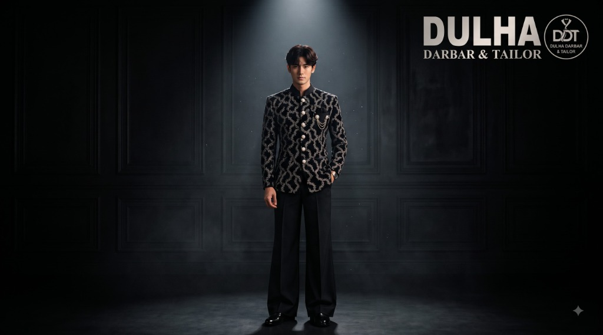

# Dulha Darbar & Tailor — Bespoke Royal Menswear Web Experience

A high-concept dark luxury digital showroom and scrollytelling web experience for **Dulha Darbar & Tailor (DDT)**. Inspired by contemporary haute-couture digital flagships and interactive 3D tailoring architectures.



---

## 🌟 Key Features

* **8-Second Video Hero Background**: Fullscreen looping video with chiaroscuro vignette, radial spotlight, and live status readouts.
* **GSAP Motion Suite**:
  * **120 FPS Custom Cursor Follower**: Dual-layer magnetic gold tracker using `gsap.quickTo`.
  * **Entrance Timelines & ScrollTrigger Scrubbing**: Staggered typography reveals and parallax video scaling.
  * **Chapter 01 (The Silhouette)**: Continuous sinusoidal breathing animation on the model spotlight portrait.
  * **Chapter 02 (Deconstructed Tailoring)**: Interactive exploded view decomposing the garment into 4 master tailoring layers.
  * **Chapter 03 (360° Studio Inspection)**: Multi-angle turntable with 6 camera perspectives and 2.2x macro magnification loupe on hover.
  * **Chapter 04 (Royal Lookbook)**: Asymmetric editorial gallery with embedded dynamic runway video card (`transition-video.mp4`).
* **Bespoke Consultation & WhatsApp Concierge**: Slide-out glass drawer with event date picker, ensemble selector, fitting mode buttons, and pre-formatted WhatsApp direct concierge booking.

---

## 🛠️ Tech Stack

* **Framework**: React 19 + TypeScript + Vite
* **Styling**: Tailwind CSS v4
* **Animations**: GSAP (GreenSock) + ScrollTrigger + Framer Motion
* **Typography**: Cinzel Decorative, Cormorant Garamond, JetBrains Mono, Plus Jakarta Sans
* **Icons**: Lucide React

---

## 🚀 Getting Started

### 1. Clone the repository
```bash
git clone https://github.com/<your-username>/<your-repo-name>.git
cd <your-repo-name>
```

### 2. Install dependencies
```bash
npm install
```

### 3. Start development server
```bash
npm run dev
```
Open [http://localhost:3000](http://localhost:3000) to view the live website.

### 4. Build for production
```bash
npm run build
```

---

## 📂 Project Structure

```
├── public/
│   └── assets/
│       ├── hero-bg-video.mp4           # 8-second looping video background
│       ├── transition-video.mp4        # 5-second dynamic runway transition
│       ├── brand-logo.png              # DDT royal emblem
│       ├── angle-1-front.jpg           # High-res front view
│       ├── angle-2-back.jpg            # Contoured back spinal view
│       ├── angle-3-right.jpg           # Right profile view
│       ├── angle-4-left.jpg            # Left profile view (brooch & drape chain)
│       ├── angle-5-perspective.jpg     # 3/4 royal perspective
│       ├── angle-6-topdown.jpg         # Top-down mandarin collar view
│       ├── model-spotlight.jpg         # Full-length spotlight campaign portrait
│       └── model-editorial.jpg         # High-fashion editorial shot
├── src/
│   ├── components/
│   │   ├── CustomCursor.tsx            # GSAP 120fps magnetic cursor follower
│   │   ├── Navbar.tsx                  # Floating header with WhatsApp concierge
│   │   ├── HeroSection.tsx             # 8s video background & GSAP parallax scrub
│   │   ├── ChapterSilhouette.tsx       # Chapter 01: The Silhouette & metrics
│   │   ├── ChapterDeconstructed.tsx    # Chapter 02: Exploded tailoring anatomy
│   │   ├── ChapterStudio360.tsx        # Chapter 03: 360° turntable & macro zoom
│   │   ├── ChapterLookbook.tsx         # Chapter 04: Lookbook & runway motion
│   │   ├── ConsultationModal.tsx       # Chapter 05: Private fitting booking drawer
│   │   └── Footer.tsx                  # Monolithic footer & atelier directory
│   ├── App.tsx
│   ├── main.tsx
│   └── index.css
├── package.json
└── vite.config.ts
```

---

## 📜 License & Credits

Tailored for **Dulha Darbar & Tailor**. All rights reserved.
